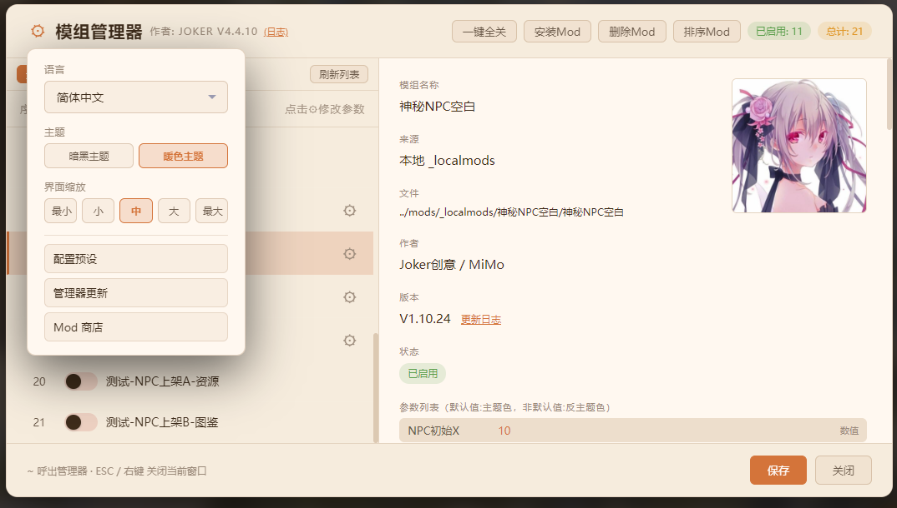
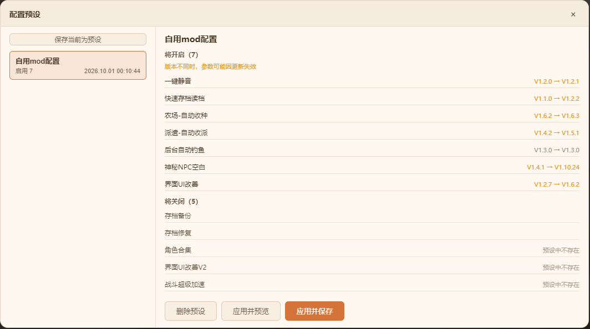
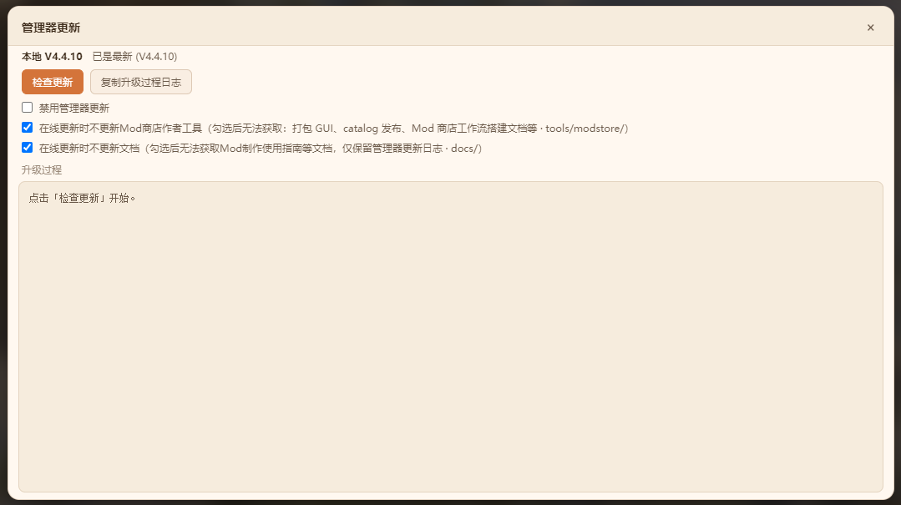
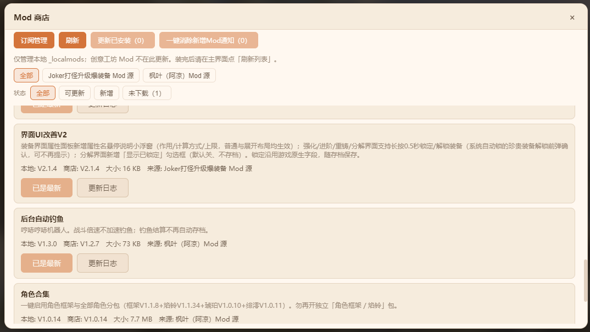
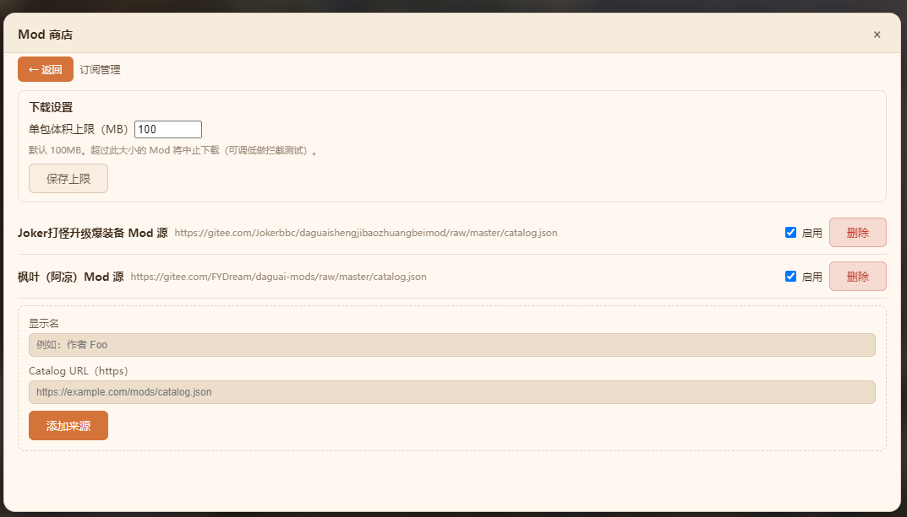
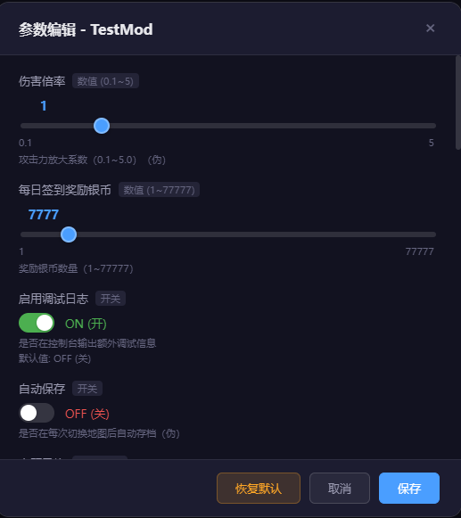
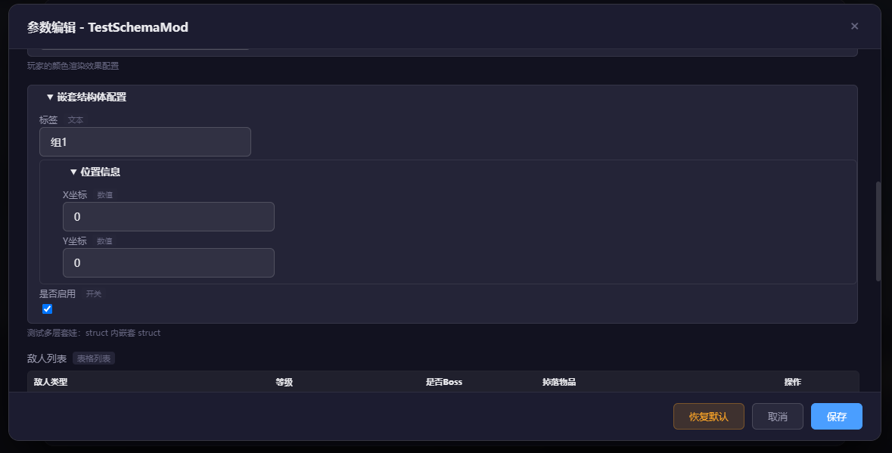
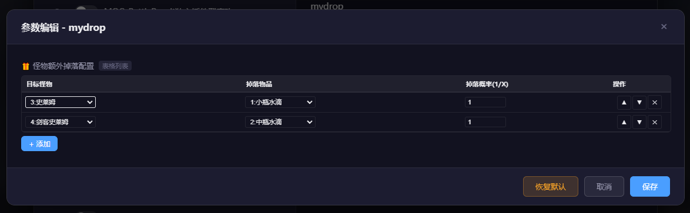
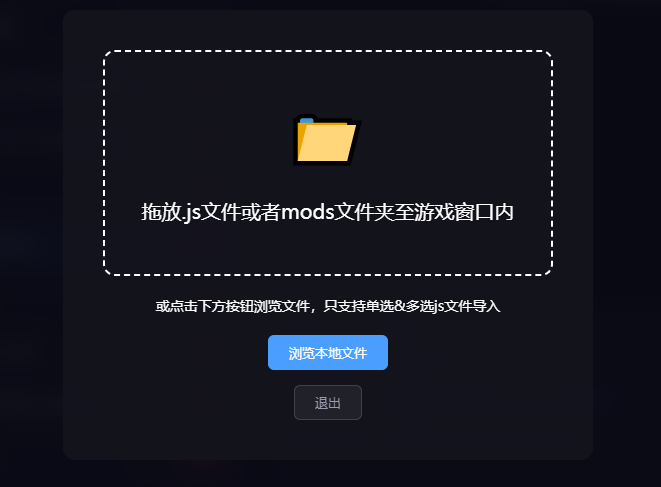
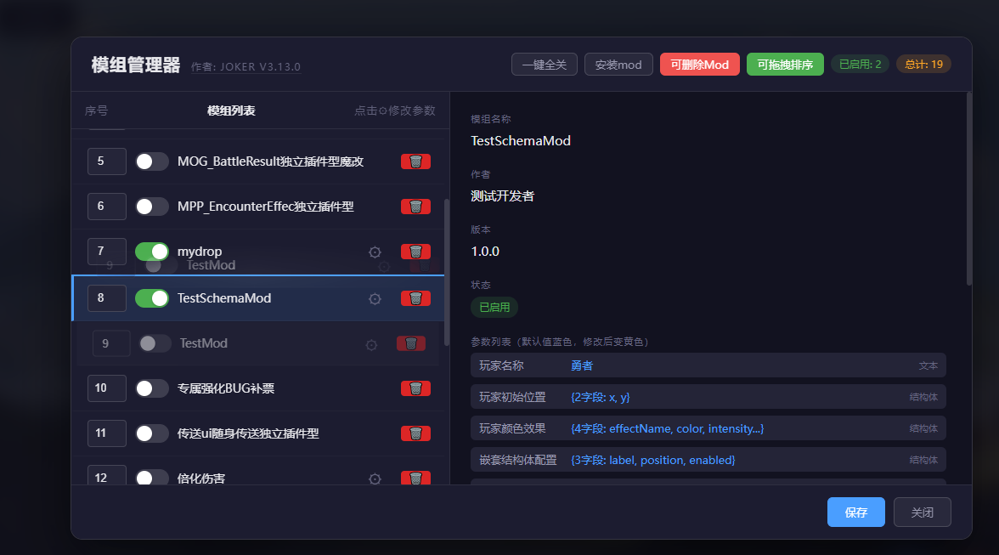

<!-- 本文件由 tools/manager-release/catalogCore.js 从 js/mods/docs/ 自动生成，请勿手改 -->

# RMMZ ModLoader

[](https://github.com/jokerBBC/rpg-maker-mz-mod-loader/blob/main/LICENSE)
[](https://github.com/jokerBBC/rpg-maker-mz-mod-loader/releases/latest)
[](https://github.com/jokerBBC/rpg-maker-mz-mod-loader/releases)

**[English README](README-en.md)**

游戏内模组管理器 **V4.5.4**

RPG Maker MZ 游戏内 Mod 管理分发平台：**本地 Mod / Steam 创意工坊 / Mod 商店**多路分发、在线更新，开关、参数编辑、排序与依赖检测一站完成。**支持多语言界面**（简体中文 / 繁體中文 / English）。
AI时代，Mod代码、mod的游戏资源生产已经不是问题，Mod管理器瓶颈从玩家如何方便用UI管理mod，Mod作者如何方便制作mod转移到了：Mod标准化（兼容）——初始分发——后续mod维护更新——玩家无痛更新mod。基于生产容易，分发维护才是新痛点的背景。
现推出完善的AI工作流：Mod制作-Mod源搭建-整合包制作-玩家安装-Mod在线推送更新 链路打通

**为什么不用替换文件式 Mod 管理器**：

- **对游戏 0 污染**：只往 `index.html` 注入一行启动顺序，全部 Mod 文件都在 `js/mods/` 文件夹内——代码、数据、资源都不碰游戏原文件
- **不用重复打包**：游戏更新、Mod 更新后，不需要重新打包「带 Mod 文件的游戏副本」，F5后Mod更新立即生效。
- **不用打开其他程序**：游戏内直接管理 Mod 的开关、参数与排序
- **分发更方便**：Steam 创意工坊订阅 + Mod 商店 + 本地拖放 / 浏览安装，玩家多渠道获取
- **参数标准化**：`@param` / `@type` / `@default` 规范统一，AI 抄作业做 Mod 更方便

> **运行环境**：RPG Maker MZ（NW.js）  
> **Mod 配置**：保存在 `mod_config.json`，游戏更新后 Mod 开关与参数也不会丢失  
> **创意工坊**：需 Steam 正版安装路径才能解析工坊目录  

***

## ✨ 实际运用案例

- 使用 RMMZ ModLoader V4.1.2 做 Mod 的游戏「挂机升级打怪兽」攻略站（含 Mod 管理器使用教程 · [飞书链接](https://qcnhq5e2tphh.feishu.cn/wiki/XH1jwdX5uil2ookoEF8cpN1AnJf)）
- 基于 RMMZ ModLoader V4 的「绯月仙行录」游戏微调版运用实例（[百度贴吧 1](https://tieba.baidu.com/p/10810499585?fr=personpage) · [百度贴吧 2](https://tieba.baidu.com/p/10813947286?fr=personpage)）
- 基于 RMMZ ModLoader 的「暗源崛起」Mod 管理器使用演示（B 站视频 · [BV1twYY6dEMv](https://www.bilibili.com/video/BV1twYY6dEMv/?spm_id_from=333.788.videopod.sections&vd_source=3ef6190ccbaf3b82c0dd3ef57cd79cc8&p=7)）
- **同一游戏 · 六个 Mod 源并存**：「打怪升级爆装备」玩家在 Mod 商店同时订阅 6 个不同作者的源，安装、更新、排序在同一个管理器内完成，mod作者有很多都是新手，在AI代码加持下制作出了Mod和Mod源，含新副本角色等复杂mod，供参考：
  - Joker · 便利性· <https://gitee.com/Jokerbbc/daguaishengjibaozhuangbeimod>
  - 枫叶（阿凉）·副本/新角色 · <https://gitee.com/FYDream/daguai-mods>
  - 天空遗落之物 · 副本· <https://gitee.com/nimi_sora/daguaishengjibaozhuangbeimod>
  - 天意 · <https://gitee.com/ty821251394/snow-of-nanzhao>
  - sky（白白）· <https://gitee.com/yhxxy/yhxxy>
  - 🐶作者2.0 · 便利性· <https://atomgit.com/dalapian/dog_author-2.0>
- **玩家纯 .js 做新角色 / 新副本**：该游戏玩家作者不依赖前置 Mod，用 AI 把新增 / 替换数据与资源的逻辑直接写进 `.js`——新角色如「角色合集」（角色框架 + 23 个角色分包，单入口一键启用），新副本如「地下炼金实验室」「mod副本传送门」「灾厄副本」系列等大型内容 Mod
- **管理器持续更新无适配问题**：该游戏从 V4.4.6 内核适配验证起，跟随管理器多次在线更新至 V4.5.4，游戏内一直正常使用
- Mod 商店仓库实例（AI 搭建 Mod 源的 catalog 发布链路参考，兼容性已实测）：
  - 打怪升级爆装备 Mod 源（旧内核 V4.4.6 管理器适配验证）· <https://gitee.com/Jokerbbc/daguaishengjibaozhuangbeimod>
  - 暗源崛起 Mod 源 · <https://gitee.com/Jokerbbc/dark-abyss-rises-mod>
  - 挂机升级打怪兽 Mod 源 · <https://gitee.com/Jokerbbc/guajishengjidaguaishoumod>

## ✨ 功能特性

| 功能 | 描述 |
| --- | --- |
| 🎮 **游戏内管理** | 无需额外程序，直接在游戏中管理 Mod 开关、参数与排序 |
| 🛒 **Steam 创意工坊** | 扫描 `workshop/content/<AppID>/`（AppID 可配置）；筛选、刷新列表；本地与工坊统一包结构 |
| 🏪 **Mod 商店拓展** | `libs/modStore.js`：多源 HTTPS catalog 订阅、下载/更新整包到 `_localmods`、断点续传（>50MB）；**UI 多语言**（简中 / 繁中 / English）；列表「更新日志」按钮 |
| 🔄 **管理器在线更新** | `libs/modLoaderUpdater.js`：设置内手动检查/更新 ModLoader 本体（catalog + raw 单文件）；与 Mod 商店分离；禁用开关；绿色角标加算；默认可跳过作者工具 / 文档更新（保留管理器更新日志） |
| 💾 **配置预设** | `libs/modConfigPresets.js`：设置内保存当前 Mod 开关/参数/顺序为具名预设，预览差异后一键应用（可仅预览或立刻保存）；文件在 `config/mod_presets/` |
| 📦 **统一包结构** | 本地 `_localmods/<包名>/` 与工坊订阅包根目录布局一致（V4.1）；包根 `CHANGELOG.md` 为 Mod 更新日志唯一位置（V4.2） |
| 📋 **Mod 更新日志** | 管理器详情版本旁「更新日志」；头部「(日志)」为管理器自身日志；商店 / 详情 / 管理器共用 Markdown 弹窗 |
| ⚙️ **参数编辑** | 数值、开关、文本、单选、颜色、长文本、数据库引用、struct、table |
| 🔀 **排序与依赖** | 拖拽/序号排序；`@base` / `@orderAfter` 依赖检测；缺失 `@base` 时自动跳过加载（依赖守卫） |
| ⚠️ **脚本同名冲突** | 与游戏插件或多 Mod 脚本基名重复时列表/详情提示；开启无效项时确认（V4.4.2） |
| ⚠️ **冲突日志面板** | 设置齿轮菜单底部入口 + 管理器内空壳面板（内容由 Mod `render` 填充）；有冲突时齿轮旁红叹号 |
| 📥 **拖放 / 浏览安装** | 拖放或浏览 `.js`；拖放 / 浏览整个 `mods` 文件夹（仅本地 Mod；V4.4.1 统一管线） |
| 🖼️ **预览图** | 包根 `preview.png`；详情缩略 + 点击弹窗大图 |
| 🛡️ **配置兼容** | V4.1.1 读取 V3.x `../mods/` 旧键；保存一次自动升级为新键 |
| 🌐 **多语言** | 简体中文 / 繁體中文 / English |
| 🎨 **双主题** | 暗黑 / 暖色 |

***

## ✨ UI 截图（暗黑/暖色双主题）

<div align="center">

主界面-创意工坊


</div>

<div align="center">

主界面



</div>

<div align="center">

配置预设



</div>

<div align="center">

管理器更新



</div>

<div align="center">

Mod 商店



</div>

<div align="center">

Mod 商店订阅管理



</div>

<div align="center">

参数编辑界面



</div>

<div align="center">

参数编辑界面-多层套娃



</div>

<div align="center">

参数编辑界面-表格



</div>

<div align="center">

安装界面



</div>

<div align="center">

删除模式和排序模式



</div>

***

## 📥 安装方式

### 模式 1：注入模式（推荐）

修改 `index.html`，在 `main.js` 之前注入 ModLoader：

```html
<body style="background-color: black">
<script type="text/javascript" src="js/libs/pixi.js"></script>
<script type="text/javascript" src="js/mods/ModLoader.js"></script>
<script type="text/javascript" src="js/main.js"></script>
</body>
```

**懒人方案 / 游戏更新后一键还原**：不想手改 `index.html`，或用整合包安装后游戏更新把入口冲掉了——用现成的「Mod管理器注入工具.bat」：放到游戏目录双击运行，**1 注入管理器** / **2 取消注入**（恢复纯净游戏）/ 3 退出。整合包安装后该工具就在游戏目录下；单独安装 ModLoader 可从仓库 `js/mods/tools/modpack/` 拷贝使用。Mod 作者制作整合包时它由打包脚本自动带上，玩家无需手改。

### 模式 2：插件模式（不推荐）

在 RMMZ 插件管理器中将 `ModLoader.js` 添加到插件列表。

> ⚠️ 修改 Mod 开关、参数或排序后，需要 **F5 刷新** 才能生效。  
> ⚠️ 创意工坊 Mod 请在 **Steam 客户端** 订阅/取消订阅。

***

## 📁 项目结构（V4.5.0）

```
js/mods/
├── ModLoader.js                    # 主入口：启动、界面、编排、对外 API
├── mod_config.json                 # Mod 开关 / 参数 / 顺序（运行时生成）
├── config/
│   ├── modloader.css
│   ├── modloader_config.json       # 管理器偏好（语言、主题、工坊等）
│   ├── mod_store.json              # Mod 商店订阅（有 modStore.js 时）
│   ├── modloader_updater.json      # 管理器更新偏好（有 modLoaderUpdater.js 时）
│   ├── mod_presets/                # 配置预设（有 modConfigPresets.js 时）
│   └── language/                   # 管理器 UI 多语言（zh_CN / zh_TW / en）
├── modloader/                      # 管理器纯逻辑（配置、扫描、安装、参数、依赖等）
├── _localmods/                     # 本地 Mod 包
│   ├── ModDataLoader/              # 数据前置 · 参考实现（已停更）
│   ├── ModResourceLoader/          # 资源前置 · 参考实现（已停更）
│   └── <包名>/
│       ├── <脚本>.js
│       ├── CHANGELOG.md            # 可选；Mod 更新日志
│       ├── preview.png             # 可选
│       └── modloader.json          # 可选（多脚本必填 version）
├── _workshop/<fileId>/             # 工坊 junction（自动生成）
├── docs/
│   ├── README.md / README-en.md
│   ├── 使用手册.md
│   ├── modloader_CHANGELOG.md
│   ├── mod商店拓展.md
│   └── img/                        # README 截图
├── libs/                           # 依赖库 + 可选扩展（存在即生效，删除即关闭）
│   ├── marked.min.js               # Markdown 渲染
│   ├── modStore.js                 # Mod 商店
│   ├── modLoaderUpdater.js         # 管理器在线更新
│   ├── modConfigPresets.js         # 配置预设
│   └── piracyGate.js               # 盗版检测闸门
└── tools/                          # 作者向工具（随在线更新分发；玩家默认勾选「不更新作者工具」不下载）
    ├── modstore/                   # Mod 商店发布工作流（AI 代办搭建）
    │   ├── README.md               #   发布工作流指南：白名单/黑名单、干跑检查、一键推送
    │   ├── modStorePublishCore.js  #   核心打包库：zip + sha256 + catalog 条目
    │   ├── modstore-catalog.template.json  # catalog 模板
    │   └── gui/                    #   图形打包工具（浏览器界面）
    │       ├── README.md
    │       ├── server.js / start-gui.bat / 启动Mod打包工具.bat
    │       ├── folderDialog.js / gitRemote.js / pick-folder.ps1
    │       └── public/             #   前端（index.html / app.js / app.css）
    └── modpack/                    # Mod管理器整合包 制作工作流（AI 代办构筑）
        ├── README.md               #   构筑指南：询问清单 → bundle_config → 干跑核对 → 构筑分发
        ├── bundle_config.example.json  # 构筑配置模板（入包 Mod / 商店源 / 产物命名）
        ├── install_builder.py      #   安装向导源码（游戏数据外置，PyInstaller 可编译 exe）
        ├── build_package.py        #   配置驱动打包脚本
        ├── gen_inject_bat.py       #   生成 GBK 注入工具
        └── Mod管理器注入工具.bat    #   生成物；注入 / 取消注入，随整合包进游戏目录
```

Steam 工坊订阅包（与 `_localmods` 同布局，脚本在包根）：

```
<Steam库>/steamapps/workshop/content/<AppID>/<publishedFileId>/
  modloader.json
  preview.png
  YourMod.js
```

***

## 📖 开发资源

### 前置 Mod

鉴于 AI 代码能力大幅提高，**前置 Mod 不再更新**。数据库与游戏资源的替换 / 新增不必依赖前置 Mod——AI 直接写进 `.js` 文件即可：一个 Mod 内置新增 / 替换数据与资源的逻辑，就能做新角色、新副本等内容。

只有当多个 Mod 之间需要统一数据合并 / 资源替换口径（更容易兼容）时，才需要考虑前置 Mod：可以参考仓库内既有实现（`_localmods/ModDataLoader`、`_localmods/ModResourceLoader`），用 AI 制作适配自己游戏的前置；RMMZ 游戏一般没那么多 Mod，Mod 作者做个简易版本也能用。

以下为既有实现的能力概要（仅供参考，不再更新）：

| 前置 Mod | 能力概要 |
| --- | --- |
| **ModDataLoader** | 字段级 merge、整条 replace、新增条目、地图 event 级浅合并；`modloader.json` 的 `data.records` / `data.patches` 零代码注入；stableKey 智能 ID 迁移；冲突报告对接 ModLoader 日志面板 |
| **ModResourceLoader** | `modloader.json` 的 `resources` 声明式替换；`loadBitmap(modId, path)` 加载 Mod 自带图片；modId 别名（本地 / 工坊包名变化时仍可用）；可选加密绕过 |

示例包：`_localmods/TestMDL-V2`（数据）、`_localmods/TestMRL-V2`（资源）。

| 资源 | 说明 |
| --- | --- |
| [使用手册.md](js/mods/docs/使用手册.md) | 游戏制作者 / 玩家 / Mod 作者完整指南 |
| [modloader_CHANGELOG.md](js/mods/docs/modloader_CHANGELOG.md) | ModLoader 更新日志 |
| [mod商店拓展.md](js/mods/docs/mod商店拓展.md) | Mod 商店设计与测试 |
| [tools/modstore/gui/README.md](js/mods/tools/modstore/gui/README.md) | 作者打包 GUI 与 catalog 发布 |
| [Mod 商店发布工作流 · AI 代办搭建指南](js/mods/tools/modstore/README.md) | AI 代办搭建 Mod 商店源：白名单/黑名单治理、干跑检查、一键推送 |
| [整合包构筑指南 · AI 代办搭建](js/mods/tools/modpack/README.md) | AI 代办制作各 RMMZ 游戏的 Mod 管理器整合包：询问清单、bundle_config、构筑与分发 |

***

## 📝 支持的参数类型

| 类型 | 说明 | 示例 |
| --- | --- | --- |
| `number` | 数值（支持滑动条） | `@min 0 @max 100 @step 1` |
| `boolean` | 开关 | `@default true` |
| `string` | 文本 | `@default Hello` |
| `select` | 单选下拉 | `@option A @option B` |
| `color` | 颜色 | `@default #ff0000` |
| `note` / `multiline_string` | 长文本 | 多行编辑 |
| `actor` | 数据库引用 · 角色 | `@default 1` |
| `class` | 数据库引用 · 职业 | `@default 1` |
| `skill` | 数据库引用 · 技能 | `@default 1` |
| `item` | 数据库引用 · 物品 | `@default 1` |
| `weapon` | 数据库引用 · 武器 | `@default 1` |
| `armor` | 数据库引用 · 防具 | `@default 1` |
| `enemy` | 数据库引用 · 敌人 | `@default 1` |
| `troop` | 数据库引用 · 敌群 | `@default 1` |
| `state` | 数据库引用 · 状态 | `@default 1` |
| `animation` | 数据库引用 · 动画 | `@default 1` |
| `common_event` | 数据库引用 · 公共事件 | `@default 1` |
| `switch` | 数据库引用 · 开关 | `@default 1` |
| `variable` | 数据库引用 · 变量 | `@default 1` |
| `struct` | 结构体 | `@schema SchemaName` |
| `table` | 表格列表 | `@schema SchemaName` |

### 常用元数据标签

| 标签 | 说明 |
| --- | --- |
| `@text` | 参数界面显示名 |
| `@base` | 前置依赖 |
| `@orderAfter` | 应排在某插件之后 |
| `@orderBefore` | 应排在某插件之前 |
| `@define-schema` / `@schema` | struct/table 模板 |

详细规范与示例 Mod 见 [使用手册 · Mod 作者](js/mods/docs/使用手册.md#三mod-作者)。

### 功能详解（struct / @text）

#### 一、`@text` 参数别名

```javascript
@param damageMultiplier
@text 伤害倍率
@type number
@default 2
```

#### 二、Schema 模板 + struct/table

```javascript
@define-schema MonsterDropSchema
[{"name":"enemyId","text":"目标怪物","type":"enemy","default":"1"}, ...]

@param dropList
@type table
@schema MonsterDropSchema
```

读取时需 `JSON.parse()`，可参考 `TestSchemaMod.js`、`mydrop.js`。

***

## 📜 开源协议

MIT License — 详见 [LICENSE](LICENSE)

***

**版本**: V4.5.4 | **更新日期**: 2026-11-16
